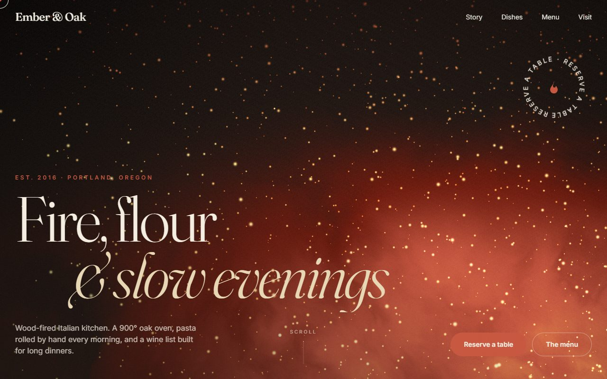

# Ember & Oak

**Restaurant website** · a concept project by [Mayank Mehra](https://mayankmehra.pages.dev)

[](https://ember-and-oak-9m9.pages.dev)

**Live site:** https://ember-and-oak-9m9.pages.dev

## The brief

A wood-fired Italian restaurant that needed a site as warm and dramatic as its kitchen, plus a menu and table reservations.

## Signature moment

Real-time WebGL fire with 1,800 ember particles that scatter from your cursor.

## What I built

- Custom fire shader and ember particle system
- Preloader, smooth scroll, custom cursor, magnetic buttons
- Horizontal "signature dishes" scroll and zoom-out gallery
- Tabbed menu with floating dish previews, reservation form

## Tech

Astro · Three.js · GSAP · Tailwind CSS · Lenis

## Run it locally

```bash
npm install
npm run dev       # http://localhost:4321
npm run build     # static site in dist/
```

---

More of my work: **[mayankmehra.pages.dev](https://mayankmehra.pages.dev)**
